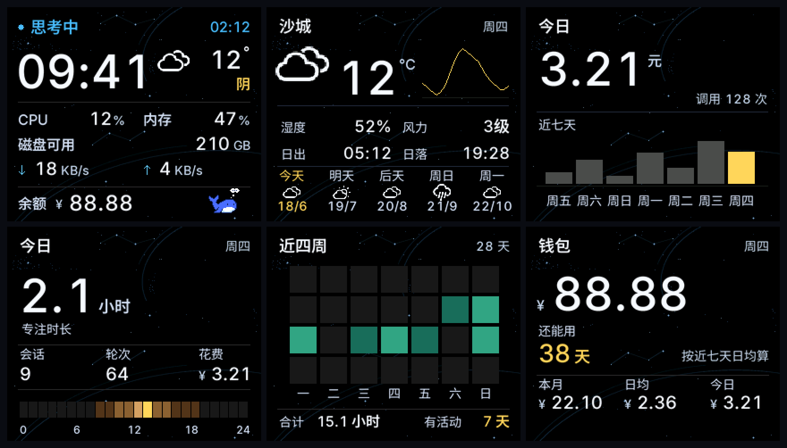

# ESP32 desk status board · 桌面状态牌

A 284×240 desk board for your Mac: weather, machine load, AI usage, spending, and activity heatmaps — driven by one serial protocol, three buttons, no cloud.



*Screenshots rendered with sample data (host-side harness, same firmware code).*

> Built for DeepSeek Harness users, but the firmware and the serial protocol are generic — any script that writes a `DSH|...` line can feed it.

## Pages · 六页

| Key · 键 | Page 1 | Page 2 |
|---|---|---|
| Left · 左 | **Weather** — current temp + 24 h curve, humidity, wind, sunrise/sunset, 5-day forecast | **Last 4 weeks** — activity heat calendar, total hours, active days |
| Middle · 中 | **Main** — AI state, elapsed time, 52 px clock, weather, CPU / RAM / disk / network, balance, animated whale | **Today** — focus hours, sessions, turns, today's spend, 24 h activity bar |
| Right · 右 | **Usage** — today's spend, call count, 7-day bar chart | **Wallet** — balance, days left at current burn rate, month / daily / today |

Every key is a two-page toggle: press once for page 1, again for page 2.

## Hardware

| | |
|---|---|
| MCU | ESP32-S3 (16 MB flash, 8 MB OPI PSRAM) |
| Display | ST7789 240×284, `setRotation(3)` → 284×240, RGB565, SPI2 @ 40 MHz |
| Pins | SCK 15, MOSI 16, CS 7, DC 6, RST 5, BL 4 |
| Buttons | left 47, middle 2, right 1 (pulldown, active high) |
| Host link | native USB-Serial/JTAG, `/dev/cu.usbmodem*` |

## How it works

```
Mac bridge (Python)                        ESP32-S3 firmware
  samples: balance / weather / CPU /          parses one line per frame
  RAM / disk / net / usage ledger /           redraws only the active page
  AI session state                          15 s without a frame → offline
        │
        └── 46 fields, pipe separated, ≤768 bytes, every 0.5 s ──▶
```

- Rendering goes into a PSRAM sprite and is pushed once per frame — no full-screen `pushImage`, no gradients (RGB565 banding).
- Text is a 4bpp anti-aliased subset font, blended against the *actual* star-field pixel, not an assumed black background.
- The bridge keeps slow APIs (weather, balance) on background threads so the serial heartbeat never stalls.

## Build & flash

```bash
FQBN='esp32:esp32:esp32s3:FlashSize=16M,PSRAM=opi,PartitionScheme=app3M_fat9M_16MB,CDCOnBoot=cdc'
arduino-cli compile --fqbn "$FQBN" dsh_badge
arduino-cli upload  -p /dev/cu.usbmodem11401 --fqbn "$FQBN" dsh_badge
```

Libraries: [LovyanGFX](https://github.com/lovyan03/LovyanGFX) (MIT). Arduino-ESP32 core 3.x.

> **Always restart the bridge after flashing** — the USB device re-enumerates and the old serial handle writes into the void, which looks exactly like "the board went offline".

## Bridge

```bash
mkdir -p ~/.config
echo '{"deepseek_api_key": "sk-..."}' > ~/.config/dsh-badge.json   # chmod 600
python3 bridge/dsh-badge.py --port /dev/cu.usbmodem11401
```

Optional: `bridge/dsh-state.mjs` (Node ≥ 22) reads DeepSeek Harness session files and reports whether a turn is running; the bridge spawns it automatically.

## Fonts

`dsh_badge/ui_fonts.h` is generated from **Inter** and **Noto Sans SC** (both SIL OFL 1.1). The font files are not vendored — to regenerate:

```bash
mkdir -p fonts
curl -L -o fonts/Inter.ttf "https://raw.githubusercontent.com/google/fonts/main/ofl/inter/Inter%5Bopsz,wght%5D.ttf"
curl -L -o fonts/NotoSansSC.ttf "https://raw.githubusercontent.com/google/fonts/main/ofl/notosanssc/NotoSansSC%5Bwght%5D.ttf"
python3 tools/build_ui_fonts.py
python3 tools/check_fonts.py     # fails loudly if any UI string is missing from the subset
```

## Tests

```bash
python3 tools/audit_bridge_test.py                                   # bridge: frame budget, ledger, short writes
node    tools/audit_state_test.mjs                                   # state engine
clang++ -std=c++17 -fsanitize=address,undefined -g \
  -I tools/host-preview tools/host-preview/audit.cpp -o /tmp/a && /tmp/a /tmp/out
clang++ -std=c++17 -fsanitize=address,undefined -g \
  -I tools/host-preview tools/host-preview/edge-audit.cpp -o /tmp/e && /tmp/e
```

`tools/host-preview/` is a host-side LovyanGFX stub: it compiles the **real** `.ino` and renders pages to PPM, so layout and parsing can be tested without the board.

## Known limits

- CPU % is a sum of `ps` samples divided by core count; RAM is summed RSS. Not Activity Monitor.
- Network counters are `en0` only.
- No CPU temperature or fan speed — not readable on Apple silicon without root.
- The board is **not** a second display. A window-mirror page was built and removed: at 284×240 and ~1.6 fps over USB-CDC, text is unreadable (`tools/mirror/` is kept behind `#define MIRROR_PAGE 0`).

## Third-party

See [THIRD-PARTY.md](THIRD-PARTY.md) — weather icons (SIL OFL 1.1, via [erikflowers/weather-icons](https://github.com/erikflowers/weather-icons)), whale (MIT, [ccch1mneyyy/dsh-TUI](https://github.com/ccch1mneyyy/dsh-TUI)), fonts (SIL OFL 1.1).

## License

MIT — see [LICENSE](LICENSE).
